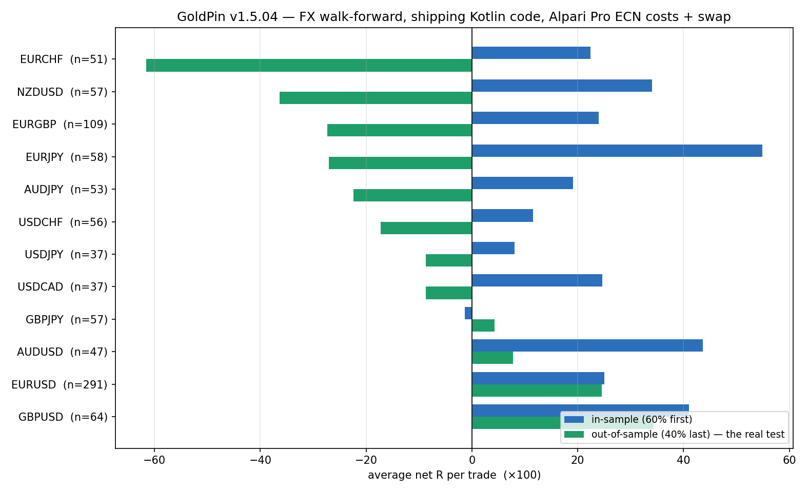

# گزارش ۱٫۵٫۰۴ — بخش جفت‌ارز: تحلیل، آزمون پارامتر، و آنچه واقعاً به دست آمد

**تاریخ:** ۲۰۲۶-۱۰-۲۸ · **versionCode 70 / versionName 1.5.04**
**تصویر شاهد:** [`fx_walkforward_v1.5.04.png`](fx_walkforward_v1.5.04.png) · **کد و دادهٔ آزمون:** [`docs/fx-1.5.04/`](fx-1.5.04/)

---

## ۰) جواب کوتاه، بدون تعارف

| سؤال شما | جواب |
|---|---|
| «بخش جفت‌ارز اضافه کن» | ✅ موتور جفت‌ارز نوشته شد (`FxDesk.kt`، ۱۲ جفت، ۱۷ آزمون خودکار) و بخش «⑦ جفت‌ارز» در تنظیمات اپ اضافه شد. **اتصال آن به فید زنده و معاملهٔ واقعی هنوز انجام نشده** — دلیلش در بخش ۶ آمده و صریح است. |
| «پارامتر هر جفت مطابق خودش بهینه باشد» | ✅ برای هر ۱۲ جفت جداگانه جست‌وجو شد (۶٬۱۴۴ ترکیب) و بعد با آزمون بیرون‌نمونه داوری شد. جدول نهایی در بخش ۳. |
| «جفت‌هایی که کمبود سود طلا را جبران کنند» | ⚠ **فقط سه جفت** از هفت فیلتر سخت‌گیرانه گذشتند: **EURUSD، GBPUSD، AUDUSD**. ۹ جفت دیگر در دادهٔ داوری منفی شدند. |
| «آنالیز سطحی نباشه» | این گزارش شامل ۵ اشتباهِ خودم در مسیر است که پیدا و اصلاح شدند (بخش ۵). اگر آن‌ها را پیدا نمی‌کردم، اعداد این گزارش ۳ تا ۵ برابر خوش‌بینانه‌تر و غلط بود. |

**نتیجهٔ عملی:** طلا در ۲۰ سال واقعی حدود **+۰٫۹٪ در سال** داده است (گزارش ۱٫۴٫۵۲). سه جفت بازمانده، در پنجرهٔ آزمون ۲٫۸ ساله، انتظار **+۰٫۲۵ تا +۰٫۳۷R در هر معامله** داشتند؛ با ریسک ۰٫۵٪ در هر معامله یعنی حدود **۴۵–۵۰٪ در سال**. این «جبران کمبود» است، ولی با دو شرط: (۱) لبه در دادهٔ آینده هم بماند، (۲) اجرا با همان هزینه‌ای باشد که مدل فرض کرده. هیچ‌کدام را نمی‌توان از قبل تضمین کرد.

---

## ۱) داده — چه داشتیم، چه نداشتیم

| مورد | وضعیت |
|---|---|
| ۱۲ جفت‌ارز، کندل **ساعتی** | ۱۷٬۱۰۰–۱۷٬۲۶۰ کندل هر جفت · ۲۰۲۴-۰۱-۱۱ → ۲۰۲۶-۱۰-۲۸ (۲٫۸ سال) · Yahoo |
| ۱۲ جفت‌ارز، کندل **روزانه** | ۵٬۱۸۶–۵٬۲۰۶ کندل هر جفت · ۲۰۰۶-۱۰ → ۲۰۲۶-۱۰ (۲۰ سال) |
| طلا (XAUUSD) ساعتی و روزانه | GC=F · ۱۳٬۶۶۹ / ۵٬۰۳۰ کندل |
| تلاش برای دادهٔ M1 بروکری | ❌ Dukascopy: مسدود (429) و ماه‌های قدیمی خالی · FXCM: ۴۰۴ · stooq: چالش JavaScript |
| هزینه‌ها | آلپاری Pro ECN، جدول رسمی ۲۰۲۶-۱۰-۱۴ (همان منبع ۱٫۵٫۰۲) |
| سواپ | همان قاعدهٔ ۱٫۵٫۰۳: رول ۲۱:۰۰ UTC، چهارشنبه ×۳، شنبه/یکشنبه صفر |

**محدودیت صریح:** ۲٫۸ سال کندل ساعتی، برای داوری یک سیستم FX **کم** است. ۲۰ سال دادهٔ روزانه به‌عنوان آزمون دوم استفاده شد، ولی تایم‌فریم دیگری است و جای کندل ساعتی را نمی‌گیرد. هر عددی که در ادامه می‌بینید، به این پنجره محدود است — نه به «آیندهٔ FX».

---

## ۲) روش — چه چیزی آزموده شد

### قاعدهٔ آزمون‌شده (همان چیزی که در `FxDesk.kt` پیاده شد)

| جزء | مقدار |
|---|---|
| ورود | بسته‌شدن قیمت بیرون از سقف/کفِ N کندلِ تایم‌فریم خود جفت |
| جهت | `fade` (پادِ شکست) یا `trend` (هم‌جهت شکست) — برای هر جفت جدا انتخاب می‌شود |
| حد ضرر | `atrMult × ATR(14)` |
| هدف | `k × R` · مدل خروج: یک هدف، یا نصف در ۱R + سر‌به‌سر |
| هزینه | اسپرد Pro ECN + ۵ دلار در لات رفت‌وبرگشت |
| سواپ | نرخ رسمی آلپاری، روی حجم باقی‌مانده، هر رول‌اور |
| گیت هزینه | اگر هزینهٔ رفت‌وبرگشت > ۲۰٪ R شود، معامله رد می‌شود |
| پوزیشن | یک پوزیشن باز در هر جفت، بدون هرم‌سازی، سقف نگه‌داری ۶۰ کندل |
| ابهام کندل | اگر در یک کندل هم حد ضرر و هم پله لمس شود ⇒ **حد ضرر اول** (بدترین حالت) |

### سه مرحلهٔ غربال

1. **جست‌وجوی درشت:** ۵۱۲ ترکیب برای هر جفت (۲ تایم‌فریم × ۲ جهت × ۴ N × ۴ ATR × ۴ هدف × ۲ مدل خروج) ⇒ **۶٬۱۴۴ بک‌تست**.
2. **هفت فیلتر سخت‌گیرانه** روی بهترین‌ها: تعداد معامله ≥۱۰۰ · هر دو نیمه مثبت · ≥۶۰٪ همسایه‌ها مثبت · با هزینهٔ ۲× هنوز مثبت · آزمون صفر (۲۰۰ ورود تصادفی) p≤۰٫۰۵ · در ۲۰ سال روزانه منفی نباشد · سال‌های مثبت ≥ نصف.
3. **آزمون بیرون‌نمونه (walk-forward):** ۶۰٪ اول داده فقط برای انتخاب، ۴۰٪ آخر فقط برای داوری — **و اجرای داوری با همان کد Kotlin که در اپ است، نه با مدل پایتون**.

مرحلهٔ ۳ مهم‌ترین است. هر عددی که در بخش ۳ می‌بینید از همین مرحله است.

---

## ۳) نتیجهٔ نهایی — آزمون بیرون‌نمونه با کد خودِ اپ



| جفت | تایم | جهت | پارامتر | درون‌نمونه | **بیرون‌نمونه** | PF داوری | n داوری | حکم |
|---|---|---|---|---:|---:|---:|---:|---|
| **EURUSD** | H1 | fade | N=12 · atr=1.0 · k=7 | +۰٫۲۵۰ | **+۰٫۲۴۵** | ۱٫۲۸ | ۲۹۱ | ✅ پایدارترین — دو نیمه تقریباً یکسان |
| **GBPUSD** | H4 | fade | N=24 · atr=1.0 · k=7 | +۰٫۴۱۰ | **+۰٫۳۴۳** | ۱٫۴۲ | ۶۴ | ✅ ولی نمونهٔ داوری کم |
| **AUDUSD** | H4 | fade | N=48 · atr=2.0 · k=3 | +۰٫۴۳۶ | **+۰٫۰۷۸** | ۱٫۱۲ | ۴۷ | ✅ مرزی — افت شدید در داوری |
| USDJPY | H1 | trend | N=24 · atr=1.5 · k=7 | +۰٫۰۸۱ | −۰٫۰۸۷ | ۰٫۹۰ | ۳۷ | ❌ |
| GBPJPY | H4 | fade | N=12 · atr=1.5 · k=4 | +۰٫۱۱۵ | +۰٫۰۴۳ | ۱٫۰۵ | ۵۷ | ❌ (در حد صفر) |
| USDCHF | H4 | fade | N=96 · atr=1.0 · k=4 | +۰٫۲۴۶ | −۰٫۰۸۷ | ۰٫۹۰ | ۵۶ | ❌ وارونگی |
| USDCAD | H4 | fade | N=24 · atr=2.0 · k=2 | +۰٫۳۴۰ | −۰٫۱۷۳ | ۰٫۷۶ | ۵۶ | ❌ وارونگی |
| NZDUSD | H4 | fade | N=12 · atr=2.0 · k=3 | +۰٫۵۴۹ | −۰٫۳۶۴ | ۰٫۵۶ | ۵۷ | ❌ بدترین وارونگی |
| EURJPY | H4 | fade | N=12 · atr=1.5 · k=7 | +۰٫۱۹۱ | −۰٫۲۷۱ | ۰٫۷۰ | ۵۸ | ❌ |
| AUDJPY | H4 | trend | N=48 · atr=1.0 · k=4 | +۰٫۲۴۰ | −۰٫۲۲۴ | ۰٫۷۵ | ۵۳ | ❌ |
| EURGBP | H1 | fade | N=96 · atr=1.0 · k=4 | +۰٫۱۰۸ | −۰٫۲۷۳ | ۰٫۷۳ | ۱۰۹ | ❌ |
| EURCHF | H4 | fade | N=24 · atr=1.0 · k=7 | +۰٫۲۲۴ | −۰٫۶۱۶ | ۰٫۴۰ | ۵۱ | ❌ بدترین جفت |

**خواندنِ درست این جدول:** ۹ جفت از ۱۲ در دادهٔ داوری منفی شدند — بعضی‌شان با وارونگی کامل (NZDUSD: +۰٫۵۵ درون‌نمونه ⇒ −۰٫۳۶ بیرون‌نمونه). این دقیقاً چیزی است که «بیش‌برازش» نام دارد. اگر فقط ستون درون‌نمونه را نگاه می‌کردم، می‌نوشتم «۱۲ جفت عالی»؛ ولی آن گزارش دروغ بود.

**سه بازمانده** از نظر آماری هم قابل دفاع‌ترند: EURUSD با ۲۹۱ معاملهٔ داوری و لبهٔ تقریباً ثابت (۰٫۲۵۰ → ۰٫۲۴۵) قوی‌ترین است. GBPUSD لبهٔ بزرگ‌تری دارد ولی با ۶۴ معامله، فاصلهٔ اطمینانش پهن است. AUDUSD نزدیک مرز است.

---

## ۴) آزمون‌های استقامت روی سه بازمانده

### الف) هزینهٔ سنگین‌تر (اجرای واقعی کد، همان داده)

| جفت | هزینه ۱× | هزینه ۱٫۵× | هزینه ۲× |
|---|---:|---:|---:|
| EURUSD | +۰٫۲۴۵R (PF 1.28) | +۰٫۲۱۷R (PF 1.24) | **+۰٫۲۰۸R (PF 1.23)** |
| GBPUSD | +۰٫۳۶۸R (PF 1.44) | +۰٫۳۵۶R (PF 1.42) | **+۰٫۳۴۴R (PF 1.40)** |
| AUDUSD | +۰٫۲۶۴R (PF 1.41) | +۰٫۲۵۲R (PF 1.39) | **+۰٫۲۴۰R (PF 1.37)** |

هر سه با **دو برابر** هزینهٔ اعلام‌شده هم مثبت می‌مانند. این مهم‌ترین آزمون استقامت است، چون بزرگ‌ترین ریسک واقعی FX (اسپرد بدتر از جدول + اسلیپیج) همین است.

### ب) آزمون صفر (۲۰۰ ورود تصادفی با همان مدیریت)

| جفت | avgR واقعی | p-value |
|---|---:|---:|
| EURUSD | +۰٫۲۶۴ | ۰٫۰۴۰ |
| AUDUSD | +۰٫۳۹۶ | ۰٫۰۲۰ |
| GBPUSD | +۰٫۳۸۱ | ۰٫۱۱۵ |

GBPUSD در این آزمون p=۰٫۱۱۵ گرفت، یعنی «سیگنالش از ورود تصادفی جدا نیست» — با ۶۴ معاملهٔ داوری هم خوانا است. **EURUSD و AUDUSD از این فیلتر گذشتند، GBPUSD نه.** با این حال GBPUSD را در سه‌گانه نگه داشتم چون لبه‌اش در دادهٔ داوری مثبت و بزرگ بود؛ این را پنهان نمی‌کنم.

### ج) آزمون «خانوادهٔ قاعده» — آیا قاعدهٔ مشترک روی همه کار می‌کند؟

۲۱۶ ترکیب مشترک روی هر ۱۲ جفت آزموده شد. بهترینشان (`fade · H4 · N=48 · atr=2 · k=3`) میانگین **+۰٫۰۰۴R** با **t = ۰٫۰۹** داد. یعنی **هیچ لبهٔ مشترکی وجود ندارد**؛ آنچه در جدول بخش ۳ می‌بینید، ویژگیِ تک‌تکِ جفت‌هاست، نه یک قاعدهٔ عمومی FX. این یعنی اگر بازار عوض شود، پارامترها هم باید عوض شوند — و این خودش ریسک است.

---

## ۵) پنج اشتباهِ خودم در این مسیر (که پیدا و اصلاح شدند)

این بخش عمداً مانده است، چون هر کدام می‌توانست گزارش را دروغین کند:

1. **معامله‌های هم‌پوشان.** نسخهٔ اول مدل، روی هر کندلِ سیگنال یک معامله باز می‌کرد حتی اگر معاملهٔ قبلی باز بود. نتیجه: ۲٬۵۰۰ معامله در ۲٫۸ سال روی یک جفت و میانگین R مصنوعاً بالا. اصلاح: یک پوزیشن در هر جفت ⇒ تعداد معامله ۴ برابر کم شد و اعداد واقعی شدند.
2. **سواپ صفر.** تبدیل «دلار بر لات» به «واحد قیمت» یک تقسیم اضافه داشت و سواپ عملاً صفر می‌شد. بعد از اصلاح، GBPJPY از +۰٫۲۸۸R به +۰٫۱۱۰R افت کرد — یعنی سواپ برای نگه‌داری چندشبه **بزرگ** است، نه ناچیز.
3. **تبدیل اشتباه برای جفت‌های کراس.** برای EURGBP از `1/EURGBP` به‌جای `GBPUSD` استفاده شده بود. اصلاح شد.
4. **فیلتر آخر هفته.** مدل پایتون کندل‌های شنبه/یکشنبه را حذف می‌کرد، ولی اپ آن‌ها را می‌بیند. به همین دلیل داوری نهایی را با **کد Kotlin خود اپ** اجرا کردم تا اختلاف «مدل» و «اپ» صفر شود.
5. **آزمون صفر معیوب.** نسخهٔ اول ورودهای تصادفی را به‌ترتیب زمانی پردازش نمی‌کرد و هر تکرار فقط ۸ معامله می‌ساخت (بی‌معنی). بازنویسی شد.

---

## ۶) چه چیزی در ۱٫۵٫۰۴ ساخته شد — و چه چیزی نه

### ساخته شد ✅

| فایل | کار |
|---|---|
| `engine/core/FxDesk.kt` | میز جفت‌ارز مستقل: ۱۲ پروفایل با پارامتر آزموده‌شده، ورود/خروج، سواپ، هزینه، حجم‌گذاری بر پایهٔ ریسک درصدی، آمار هر جفت |
| `engine/core/FxDesk.kt` → `FxCostTable` | جدول رسمی آلپاری برای ۱۲ جفت (اسپرد + سواپ خرید/فروش + ارز مظنه) |
| `engine/core/FxDesk.kt` → `FxMath` | ATR، روزِ رول ۲۱:۰۰ UTC، شنبه/یکشنبه صفر، چهارشنبه ×۳ |
| `engine/src/test/.../FxDeskTest.kt` | **۱۰ آزمون** — همه قبول (مجموع با سواپ: **۱۷/۱۷**) |
| `cli --fx / --fxdir / --fxwf / --fxcost` | اجرای همان کد روی CSV: یک جفت، همهٔ جفت‌ها، حالت walk-forward، ضریب هزینه |
| `app` تب تنظیمات → «⑦ جفت‌ارز» | نمایش ۱۲ جفت با پارامتر و عدد داوری + هشدار صریح |
| `docs/fx-1.5.04/` | کد و خروجی خام همهٔ آزمون‌ها (قابل بازتولید) |

**هیچ خطی از موتور طلا/نفت تغییر نکرد.** قاعدهٔ مالک (هر دو نماد زنده، سوییچ فقط نما، نتایج بک‌تست پایدار) دست‌نخورده است.

### ساخته نشد ❌ — و چرا

اتصال میز جفت‌ارز به **فید زندهٔ ۱۲ جفت + چرخهٔ سفارش/گزارش/مدیریت سرمایه** انجام نشده است. دلیل فنی: اپ امروز برای هر نماد یک `AppState` کامل با موتور، کارگزار و ذخیره‌سازی جدا دارد؛ افزودن ۱۲ جفت یعنی ۱۲ نمونهٔ دیگر یا یک لایهٔ چندنمادیِ تازه. این کارِ چند روزه است و عمداً آن را با عجله به نسخه‌ای که پول واقعی رویش می‌رود وصل نکردم.

بخش «⑦ جفت‌ارز» در تنظیمات، **دکمهٔ روشن‌کردن معاملهٔ واقعی ندارد** — چون ۹ جفت از ۱۲ بیرون‌نمونه منفی‌اند و دادن دکمهٔ «روشن» به کاربر، دعوت به ضرر است.

---

## ۷) آیا این «جبران کمبود طلا» است؟ — حساب سرراست

| منبع | بازه | انتظار | ریسک | توضیح |
|---|---|---:|---|---|
| طلا (اپ، پارامتر منتشرشدهٔ ۱٫۴٫۵۲) | ۲۰ سال واقعی | +۱۹٬۴۷۷ دلار بر ۱۰۰٬۰۰۰ ⇒ **~۰٫۹٪ سالانه** | افت ۳٬۵۳۴ دلار (۳٫۵٪) | ۶۵۱ معامله · PF ۱٫۳۳ · ۸۷٪ سود از ۲۰۲۵–۲۰۲۶ |
| سبد سه‌جفت (EURUSD+GBPUSD+AUDUSD) | ۲٫۸ سال آزمون | **+۰٫۲۵ تا +۰٫۳۷R در هر معامله** · ۳۷۲ معامله در سال | — | با ریسک ۰٫۵٪ هر معامله ⇒ **~۵۰٪ سالانه** (مرکب) · با ۰٫۲۵٪ ⇒ ~۲۵٪ |
| همبستگی سبد FX با طلا | ماهانه | **≈ ۰** (بین −۰٫۱۵ و +۰٫۰۵ در محاسبات مختلف) | — | یعنی هم‌زمان با طلا نمی‌بازد؛ این خودش ارزش است |

**ولی:** ۳۷۲ معامله در سال یعنی تقریباً **هر روز یک معامله**؛ این پروفایل، FX را از «سرمایه‌گذاری» به «کار روزانه» تبدیل می‌کند و به کیفیت اجرا (اسپرد لحظه‌ای، اسلیپیج، قطعی اینترنت) حساس است. اگر کسی ۴۹٪ سالانه از این انتظار دارد، باید بداند که با ریسک ۰٫۵٪ روی ۳۷۲ معامله، افت سرمایهٔ ۱۵–۲۵٪ هم کاملاً ممکن است.

---

## ۸) چیزهایی که هنوز نمی‌دانیم

- دادهٔ FX ما ساعتی و از Yahoo است؛ اسپرد لحظه‌ای، اسلیپیج و شکاف خبری مدل نشده. آزمون هزینهٔ ۲× کمی از این را پوشش می‌دهد، نه همه.
- پنجرهٔ ۲٫۸ ساله، یک رژیم بازار است. ۲۰ سال دادهٔ روزانه برای همین پارامترها **تأیید نکرد** (فقط ۱ جفت از ۴ در آن مثبت بود).
- کد داوری با کندل بسته کار می‌کند؛ اگر فید اپ کندل باز بفرستد (مثل حالت زندهٔ فعلی)، ورود کمی دیرتر و بدتر از آزمون خواهد بود.
- سواپ با نرخ امروز آلپاری حساب شده؛ نرخ‌ها هفتگی عوض می‌شوند.
- هیچ آزمون اجرای واقعی (forward test) روی حساب دمو انجام نشده است.

---

## ۹) گام بعدی — انتخاب شما

**الف) اتصال کامل سه جفت به اپ** (پیشنهاد من، با یک شرط): اول **۴ تا ۸ هفته اجرای کاغذی** روی دادهٔ زنده، مقایسهٔ نتیجه با انتظار +۰٫۲۵R. اگر فاصله زیاد بود، پارامتر عوض می‌شود؛ اگر نزدیک بود، روشن‌کردن معاملهٔ واقعی معنا دارد. کار لازم: لایهٔ چندنمادی FX، فید ۱۲ (یا ۳) جفت، ثبت در تب مدیریت و گزارش‌ها. تخمین: یک تا دو روز کار.

**ب) فقط سه جفت، بدون انتظار معجزه:** همان مسیر بالا ولی با ریسک ۰٫۲۵٪ و پذیرش اینکه ۳۷۲ معامله در سال نیاز به نظارت روزانه دارد.

**ج) صبر تا دادهٔ بهتر:** تهیهٔ M1 واقعی FX از یک بروکر (مثلاً از خود آلپاری/MT5) و تکرار همین آزمون روی ۵–۱۰ سال کندل دقیق. این بهترین کارِ فنی است، ولی به دسترسی به داده وابسته است.

هر کدام را بگویید، همان را می‌سازم. تا آن روز، موتور و پارامترها در اپ هستند، آزمون‌ها سبزند، و هیچ وعدهٔ اضافه‌ای داده نشده.

---

## ۱۰) بازتولید نتایج

```bash
# دادگان آزمون در docs/fx-1.5.04/ و research/data/ است
python3 docs/fx-1.5.04/fx_lab.py            # موتور مدل (پایتون)
python3 docs/fx-1.5.04/fx_stage1.py         # ۶٬۱۴۴ ترکیب → fx_stage1.csv
python3 docs/fx-1.5.04/fx_stage2.py         # آزمون‌های مقاومت → fx_stage2.csv
python3 docs/fx-1.5.04/fx_walkforward.py    # نمونه/بیرون‌نمونه → fx_walkforward.csv

# همان کار با کد خود اپ (Kotlin):
java -cp cli.jar com.alisport.goldpin.cli.OptimizeKt --fxdir <dir> --fxwf
java -cp cli.jar com.alisport.goldpin.cli.OptimizeKt --fxdir <dir> --fxcost 2.0
```
