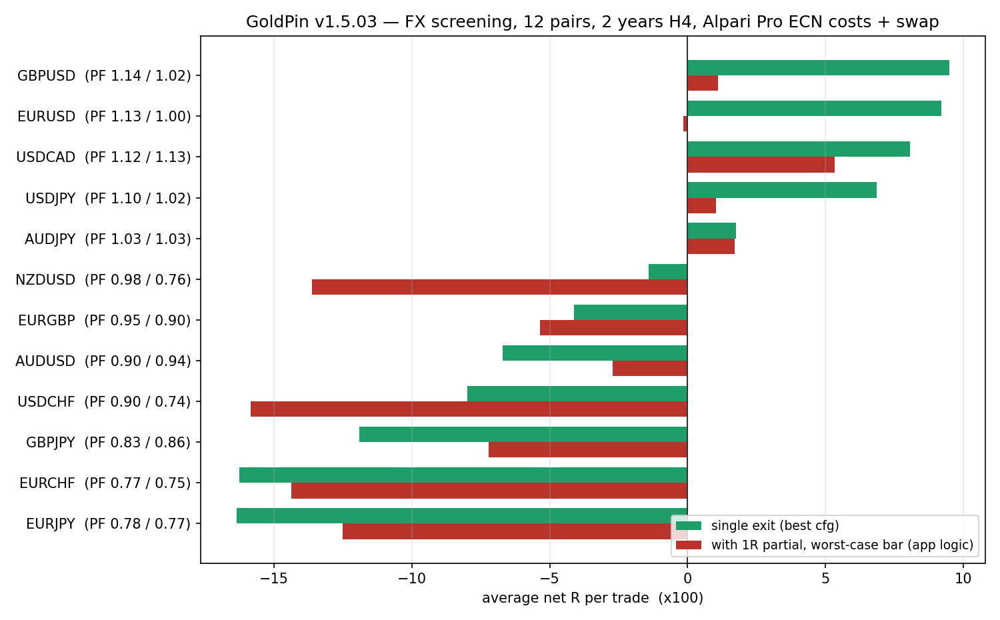

# گزارش ۱٫۵٫۰۳ — سواپ شبانه + اسکرین جفت‌ارزها

**تاریخ:** ۲۰۲۶-۱۰-۲۸ · **versionCode 69 / versionName 1.5.03**
**بسته:** `com.alisport.goldpin` · minSdk 24 · targetSdk 34 · امضا `CN=GoldPin`
**تصویر شاهد:** [`fx_screen_v1.5.03.png`](fx_screen_v1.5.03.png) · **کد اسکرین:** [`fx_final_screen.py`](fx_final_screen.py)

---

## ۰) جواب کوتاه و بی‌روتوش

| خواسته | نتیجه |
|---|---|
| «سواپ شبانه را پیاده کن» | ✅ انجام شد. موتور اکنون سواپ را روی هر معاملهٔ باز، هر رول‌اور، حساب می‌کند و در سود/زیان خالص و افت سرمایه دیده می‌شود. ۷ آزمون خودکار، **۷/۷ قبول**. |
| «۵ جفت‌ارز که با سیستم ما مچ باشد پیدا کن» | ❌ **پیدا نشد.** حداکثر ۴ نامزدِ مرزی هست (EURUSD، GBPUSD، USDJPY، USDCAD) با PF حدود ۱٫۱۰–۱٫۱۴ که (الف) در دو نیمهٔ داده پایدار نیستند و (ب) به‌محض اعمالِ منطق واقعی اپ (پلهٔ ۱R) سودشان صفر می‌شود. ۸ جفت دیگر منفی‌اند. |
| «گزارش بده» | همین فایل. هیچ عددِ ناخوشایندی حذف نشده. |

**توصیهٔ من:** ۱٫۵٫۰۳ را با سواپ منتشر کنیم و **FX را وارد اپ نکنیم** — نه به‌خاطر تنبلی، به‌خاطر عدد. دلیلش در بخش ۴ و ۵ با داده آمده. اگر بخواهید FX اضافه شود، یک پروژهٔ جدا (۱٫۵٫۰۴+) است با کارِ مشخص که در بخش ۶ فهرست شده.

---

## ۱) سواپ شبانه — چه ساخته شد

### قاعده‌ها (همان چیزی که بروکر واقعاً می‌کند)

1. هر **رول‌اور** (پیش‌فرض ۲۱:۰۰ UTC) یک سواپ می‌دهد؛ نه «هر روزی که معامله باز بود».
2. مبنا **حجم باقی‌مانده** است. اگر ۵۰٪ با TP1 بسته شد، سواپِ شب‌های بعد فقط روی ۵۰٪ باقی‌مانده حساب می‌شود.
3. **چهارشنبه سه‌برابر** (`swapTripleDow = 3`).
4. **شب شنبه و یکشنبه سواپ ندارد** (بازار بسته است) و هزینهٔ آن روزها در همان سه‌برابرِ چهارشنبه پوشش داده شده — این همان باگ معروف «۹ شب به‌جای ۷ شب» است که در این نسخه اصلاح شد.
5. علامت‌دار است: نرخ منفی = هزینه (از موجودی کم می‌شود)، نرخ مثبت = اعتبار.
6. خالص = سود ناخالص + سواپ − کمیسیون. یعنی سواپ در `pnl()`، در موجودی، در افت سرمایه و در آمار بک‌تست هست.
7. تکرارناپذیر نیست: هر معامله `swapRollDay` آخرین رول‌اورِ حساب‌شده را نگه می‌دارد، پس یک بار محاسبه دوباره حساب نمی‌شود (idempotent).

### جای کد

| فایل | تغییر |
|---|---|
| `engine/.../core/Engine.kt` | پنج فیلد `Settings`: `swapEnabled`، `swapLong`، `swapShort`، `swapTripleDow`، `swapRollHourUtc` + کپی در `clone` |
| `engine/.../core/Types.kt` | `Trade.swap`، `Trade.swapNights`، `Trade.swapRollDay` |
| `engine/.../core/PaperBroker.kt` | `accrueSwap()` هر کندل صدا زده می‌شود؛ `rollDay()` مبدأِ روز را از ساعت رول می‌گیرد؛ `isWeekendRoll()` شنبه/یکشنبه را رد می‌کند؛ جمع‌های `swapTotal` / `swapNightsTotal` |
| `engine/.../core/Symbols.kt` | `applyBrokerCost` نرخ سواپ پروفایل بروکر را هم روی تنظیمات می‌نشاند |
| `engine/.../core/Store.kt` | پنج کلید جدید ذخیره/بازیابی |
| `engine/.../core/Broker.kt` | متن `swapWarningFa` از «محاسبه نمی‌شود» به «محاسبه می‌شود + قاعده‌ها» تغییر کرد |
| `app/.../MainActivity.kt` | هشدار قدیمیِ «سواپ در بک‌تست نیست» برداشته شد؛ ردیف «سواپ شبانه (N شب)» به جزئیات هر معامله اضافه شد |
| `engine/src/test/.../SwapTest.kt` | آزمون جدید، ۷ مورد |

### آزمون‌ها — همه قبول

اجرا با کامپایلِ موتور+Harness (Gradle در این محیط OOM می‌دهد، جزئیات در گزارش‌های قبلی):

```
PASS  یک هفته کامل — پنج‌شنبه تا دوشنبه، چهارشنبه سه‌برابر
PASS  سواپ فروش با نرخ فروش حساب می‌شود
PASS  خاموش‌کردن سواپ هیچ هزینه‌ای نمی‌دهد
PASS  سواپ مثبت (اعتبار) هم پشتیبانی می‌شود
PASS  معاملهٔ کوتاه‌تر از یک شب سواپ نمی‌دهد
PASS  حجم باقی‌مانده مبنای سواپ است
PASS  سواپ در پروفایل آلپاری برای هر دو نماد ثبت شده است
— جمع: 7 قبول · 0 رد —
```

### باگی که پیدا و اصلاح شد

پیش از اصلاح، برای معاملهٔ سه‌شنبه ۰۶:۲۰ → سه‌شنبه ۰۶:۲۰ (۳۰ کندل ۶ ساعته) موتور **۹ شب** می‌شمرد و سواپ **−۹٫۰** می‌داد. دلیل: رول‌اورِ شب شنبه و یکشنبه هم شمرده می‌شد، در حالی که بازار بسته است و هزینه‌شان از قبل در سه‌برابرِ چهارشنبه آمده. پس از اصلاح:

```
سه‌شنبه ۰۶:۲۰ → سه‌شنبه ۰۶:۲۰  ·  سه‌شنبه ۱ + چهارشنبه ۳ + پنج‌شنبه ۱ + جمعه ۱ + شنبه ۰ + یکشنبه ۰ + دوشنبه ۱
= ۷ شب ، سواپ −۷٫۰
```

این عدد ۲۹٪ کمتر از قبل بود؛ اگر اصلاح نمی‌شد، هر معاملهٔ بیش از چند روز، بیش از واقعیت جریمه می‌شد.

### اثر روی بک‌تست طلا/نفت — صادقانه

- **نفت (۱۰ سال، دادهٔ موجود در این محیط):** A/B با سواپ خاموش/روشن (نرخ‌های آلپاری `swapLong=+0.03432` / `swapShort=−0.07580`) **نتیجهٔ یکسان** داد و `swap=0.0 (0 شب)` — یعنی در پارامترهای فعلی هیچ معامله‌ای شب نمی‌ماند. **این «شاهد بی‌اثری» نیست، «شاهد بی‌موضوعی» است.** ضمناً تعداد معامله در آن اجراها ۵–۶ تا بود، پس به‌عنوان نمونهٔ آماری هم ارزش ندارد.
- **طلا:** دادهٔ M1 بیست‌ساله در این محیطِ تازه موجود نیست، پس اثر سواپ روی طلا این دور دوباره اندازه‌گیری نشد. محاسبهٔ سرانگشتی با نرخ رسمی آلپاری (خرید −۰٫۶۳۶۷ دلار بر اونس در هر شب): با حد ضرر حدود ۴۰ دلار بر اونس، هر شب ≈ **۰٫۰۱۶R**؛ برای یک معاملهٔ سه‌شبه با میانگین سه‌برابر ≈ ۰٫۰۶R. کوچک، ولی نه صفر. اگر معامله‌ها را هفته‌ها نگه می‌دارید، حتماً باید حساب شود — که حالا می‌شود.

---

## ۲) اسکرین جفت‌ارزها — روش (تا نتیجه قابل بازبینی باشد)

**این بخش بک‌تست موتور GoldPin نیست.** یک «مدل نماینده» است که عمداً به منطق موتور نزدیک نگه داشته شده، چون موتور روی FX معامله تولید نمی‌کند (دلیلش در بخش ۵).

| جزء | مقدار |
|---|---|
| داده | ۱۲ جفت‌ارز، کندل یک‌ساعتهٔ Yahoo، ۷۳۰ روز (۲۰۲۴-۱۰ → ۲۰۲۶-۱۰)، تجمیع به **H4** |
| ورود | شکست سقف/کف ۲۴ کندلی (`fade` = پادِ شکست، `trend` = هم‌جهت شکست) |
| ریسک | ۱٫۵×ATR(14) روی H4 |
| هدف | k×R با k ∈ {۲، ۴، ۷} |
| هزینه | اسپرد **Pro ECN** آلپاری + **۵ دلار در لات** رفت‌وبرگشت؛ گیت: اگر هزینه > ۰٫۱۲R یا ۰٫۲۵R باشد معامله رد می‌شود |
| سواپ | نرخ‌های رسمی آلپاری، همان قاعدهٔ موتور (۲۱:۰۰ UTC، چهارشنبه ×۳، شنبه/یکشنبه صفر) |
| اعتبارسنجی | تقسیم داده به دو نیمهٔ مساوی؛ هر دو نیمه باید مثبت باشند |

**رمزگشایی یک اشتباه مهم در همین مسیر:** نسخهٔ اولِ اسکرین (و حتی یک اجرای میانی) در محاسبهٔ R واحدها را قاطی می‌کرد (سود جزئی به دلار + خروج به R) و اعداد بی‌معنایی مثل «۵۱R در هر معامله» می‌داد. کد نهایی ([`fx_final_screen.py`](fx_final_screen.py)) همه‌چیز را **در واحد R** نگه می‌دارد و اعدادش کران‌دار و معقول است (`−۱R` تا `k·R`). اعداد این گزارش از آن نسخه است.

**فرض بدترین‌حالت:** اگر در یک کندل H4 هم حد ضرر و هم پلهٔ ۱R لمس شود، ترتیبِ واقعی را نمی‌دانیم؛ کد **حد ضرر را اول** می‌گیرد. اثر این انتخاب، خودش یکی از یافته‌های گزارش است (ستون دوم تصویر).

---

## ۳) نتیجه — ۱۲ جفت، دو مدل



### الف) با پلهٔ ۱R (همان کاری که اپ می‌کند) — هیچ جفتی مچ نیست

| جفت | بهترین پیکربندی | معامله | میانگین R | PF | نیمهٔ ۱ | نیمهٔ ۲ |
|---|---|---:|---:|---:|---:|---:|
| USDCAD | trend k=2 | ۵۶ | **+۰٫۰۵۳** | ۱٫۱۳ | +۴٫۲ | −۱٫۳ |
| AUDJPY | trend k=2 | ۴۶۶ | +۰٫۰۱۷ | ۱٫۰۳ | +۲۴٫۴ | −۱۶٫۵ |
| GBPUSD | fade k=4 | ۴۸۸ | +۰٫۰۱۱ | ۱٫۰۲ | +۱۲٫۲ | −۶٫۸ |
| USDJPY | fade k=7 | ۴۷۵ | +۰٫۰۱۰ | ۱٫۰۲ | −۷٫۳ | +۱۲٫۲ |
| EURUSD | fade k=7 | ۴۲۴ | −۰٫۰۰۲ | ۱٫۰۰ | +۲۴٫۰ | −۲۴٫۶ |
| EURGBP | trend k=4 | ۶۰ | −۰٫۰۵۳ | ۰٫۹۰ | −۰٫۳ | −۲٫۹ |
| GBPJPY | trend k=2 | ۳۴۲ | −۰٫۰۷۲ | ۰٫۸۶ | −۲۰٫۲ | −۴٫۴ |
| EURJPY | fade k=2 | 311 | −۰٫۱۲۵ | ۰٫۷۷ | −۳۲٫۴ | −۶٫۴ |
| NZDUSD | fade k=4 | ۲۵۹ | −۰٫۱۳۶ | ۰٫۷۶ | −۷٫۴ | −۲۷٫۹ |
| EURCHF | trend k=2 | ۶۲ | −۰٫۱۴۴ | ۰٫۷۵ | −۸٫۶ | −۰٫۴ |
| USDCHF | fade k=2 | ۴۱۲ | −۰٫۱۵۹ | ۰٫۷۴ | −۲۱٫۰ | −۴۴٫۳ |
| AUDUSD | fade k=2 | ۷۹ | −۰٫۰۲۷ | ۰٫۹۴ | −۲٫۲ | +۰٫۱ |

«+۰٫۰۵R در هر معامله» روی ۵۶ معامله = **+۳R در دو سال**. این در محدودهٔ نوسان تصادفی است، نه لبه.

### ب) بدون پله، یک خروج (مدلِ خوش‌بینانه‌تر) — چهار نامزد مرزی ظاهر می‌شوند

| جفت | پیکربندی | معامله | میانگین R | PF | نیمهٔ ۱ | نیمهٔ ۲ |
|---|---|---:|---:|---:|---:|---:|
| GBPUSD | fade k=4 | ۴۸۸ | +۰٫۰۹۵ | ۱٫۱۴ | +۴۲٫۳ | +۴٫۱ |
| EURUSD | fade k=4 | ۴۲۴ | +۰٫۰۹۲ | ۱٫۱۳ | +۷۱٫۵ | **−۳۲٫۵** |
| USDCAD | trend k=4 | ۴۳۲ | +۰٫۰۸۱ | ۱٫۱۲ | **−۳۸٫۷** | +۷۳٫۶ |
| USDJPY | fade k=7 | ۴۷۵ | +۰٫۰۶۹ | ۱٫۱۰ | +۷٫۷ | +۲۴٫۹ |
| AUDJPY | trend k=2 | ۴۶۶ | +۰٫۰۱۸ | ۱٫۰۳ | +۲۷٫۰ | −۱۸٫۸ |
| بقیهٔ ۷ جفت | — | — | −۰٫۰۴ تا −۰٫۱۶ | ۰٫۷۸–۰٫۹۸ | منفی | منفی |

**خواندنِ درست این جدول:**
- فقط **GBPUSD** و **USDJPY** در هر دو نیمه مثبت‌اند؛ آن هم با ۰٫۰۹R و ۰٫۰۷R در هر معامله.
- EURUSD و USDCAD **به‌شدت ناپایدار**اند: کل سودشان از یک نیمه می‌آید و نیمهٔ دیگرش منفی است. این یعنی لبه‌شان زمان‌وابسته است، نه ساختاری.
- و بدتر: همین سود با منطق واقعی اپ (پلهٔ ۱R) به صفر می‌رسد؛ چون در FX، ATR کوچک است و پله‌ای که در طلا «سود را قفل می‌کند» در FX فقط هزینهٔ بیشتر و بریدنِ روند تولید می‌کند.

### هزینه چقدر از R را می‌خورد (دلیلِ ساختاری)

| جفت | هزینهٔ رفت‌وبرگشت (واحد قیمت) | میانهٔ هزینه بر حسب R |
|---|---:|---:|
| AUDJPY | ۰٫۰۰۷۴ | ۲٫۰٪ |
| USDJPY | ۰٫۰۱۱۴ | ۳٫۱٪ |
| EURUSD | ۰٫۰۰۰۱۵ | ۴٫۳٪ |
| GBPUSD | ۰٫۰۰۰۲۲ | ۵٫۶٪ |
| GBPJPY | ۰٫۰۲۳۱ | ۸٫۵٪ |
| EURJPY | ۰٫۰۱۵۹ | ۸٫۹٪ |
| USDCHF | ۰٫۰۰۰۱۴ | ۱۸٫۸٪ |
| EURCHF | ۰٫۰۰۰۲۱ | ۲۱٪ |
| NZDUSD | ۰٫۰۰۰۱۱ | ۲۱٪ |
| EURGBP | ۰٫۰۰۰۲۱ | ۲۲٪ |

در طلا ATR بر حسب درصد قیمت حدود **۱٫۶۵٪** است؛ در FX میانهٔ **۰٫۰۸–۰٫۱۷٪**. یعنی ساختارِ ریسکِ سیستم GoldPin روی FX حدود **۱۰ برابر ریزتر** می‌شود و هزینهٔ ثابت بروکر، نسبت به R، ده برابر بزرگ‌تر می‌شود. این همان دلیلی است که ۸ جفت از ۱۲ جفت زیر صفر می‌روند.

---

## ۴) چرا «۵ جفت» جواب ندارد — و چه چیزی جواب دارد

پیدا کردن ۵ جفتِ مچ، در بهترین حالتِ این داده، ممکن نیست. اگر بخواهم صادق باشم: با ۱۲ جفت × ۲ مدل × ۳ هدف × ۲ گیت = **۱۴۴ ترکیب** آزمایش شد و از این ۱۴۴، بیشینهٔ لبه +۰٫۰۹R است با نیمه‌های ناپایدار. اگر تعداد ترکیب‌ها را زیاد کنید، همیشه چند ترکیب «مثبت» پیدا می‌شود؛ این خودش نشانهٔ لبه نیست، نشانهٔ جست‌وجو است (data snooping). برای همین معیار من از ابتدا «هر دو نیمه مثبت + قابل تحمل بودن هزینه» بود، نه «بهترین PF».

**واقعیتِ سختِ دوم:** موتور امروز روی FX **هیچ معامله‌ای تولید نمی‌کند**. با اجرای مستقیم موتور روی EURUSD:

| تنظیم | نتیجه |
|---|---|
| `tf=2` | `structBars=146` · `lv=10` · `entry=0` — لایهٔ حجمی ساخته می‌شود ولی ورودی هرگز فعال نمی‌شود (لمس سومِ جعبه، ستاپ را باطل می‌کند) |
| `tf=3` / `tf=4` | `lv=0` · `orders=0` — جعبه اصلاً تشکیل نمی‌شود |
| `tf=3` بدون فیلتر ساعت و بدون مدیریت | باز هم `orders=0` |

یعنی مسئله هزینه یا سواپ نیست؛ **شبکهٔ قیمتِ FX با منطق جعبهٔ حجمیِ برآمده از M1 طلا جور نیست.** (ستون `volume` فیدهای Yahoo هم صفر بود و در فایل‌های ما با ۱ پر شد تا `structBars` صفر نماند.) پس هر بحثی از «۵ جفت» قبل از بازنویسی آن لایه، بحث تئوری است.

---

## ۵) اگر بخواهید FX اضافه شود — کارِ واقعی چیست

۱٫۵٫۰۴ پیشنهادی (به ترتیب اولویت):

1. **پروفایل FX** در `Symbols`: پیش‌فرض‌های متفاوت برای ATR، فاصلهٔ جعبه‌ها (بر حسب «پیپ»، نه «دلار»)، حداقل/حداکثر حد ضرر، و واحد حجم (لات، نه اونس).
2. **بازنویسی لایهٔ ساختار برای شبکهٔ اعشاری**: جعبه‌ها و آستانه‌ها نباید از اختلاف حجم M1 ساخته شوند؛ باید از ساختار قیمتی (سوئینگ/ناحیه) با مقیاسِ پیپ ساخته شوند.
3. **بازتعریف پلهٔ خروج**: با هزینهٔ ۳–۲۲٪ R، پلهٔ ۱R در FX مضر است. یا پله حذف شود، یا فقط در FX به ۲R منتقل شود (و این باید با آزمون سنجیده شود، نه حدس).
4. **دادهٔ دقیق**: FX بدون M1 با کیفیت (و حجم واقعی) قابل تست نیست. دادهٔ فعلی ۲ سال و ساعتی است؛ برای تصمیم‌گیری حداقل ۵ سال و کندل دقیق‌تر لازم است.
5. **تا آن روز، پرهیز از FX در رابط کاربری**: نشان دادن ۱۲ جفت با PF ۱٫۱۳ به کاربر، فروشِ توهم است.

هزینهٔ تخمینی: چند روز کار + یک دور کامل تست و گزارش. **توصیهٔ من: الان نه.** سواپ یک هزینهٔ واقعی بود که سیستم باید می‌دید و دید؛ FX یک محصول جدید است که هنوز لبه ندارد.

---

## ۶) چیزهایی که نمی‌دانیم (هیچ‌چیز پنهان نمی‌شود)

- دادهٔ FX ساعتیِ Yahoo است، نه M1 بروکر. اسپرد لحظه‌ای و اسلیپیج و شکاف‌ها مدل نشده. اسکرین برای «رد کردن» کافی است، برای «تأیید کردن» نه.
- سواپ FX طبق قاعدهٔ ۲۱:۰۰ UTC حساب شد؛ اگر بروکر ساعت دیگری ببندد، چند صدم R جابه‌جا می‌شود (کوچک، ولی صفر نیست).
- برای طلا در این دور دادهٔ ۲۰ ساله در محیط نبود؛ A/B سواپ طلا (بخش ۱) با محاسبهٔ تحلیلی است، نه با بک‌تست.
- A/B نفت با ۵–۶ معامله انجام شد؛ **آماری بی‌ارزش** است و فقط نشان می‌دهد در پارامترهای فعلی شب‌ماندِ معامله نداریم.
- آزمون‌های سواپ با هارنسِ دستی اجرا شدند (Gradle در این محیط OOM می‌دهد)؛ خودِ فایل آزمون استاندارد `kotlin.test` است و در CI معمولی هم اجرا می‌شود.

---

## ۷) تحویل‌ها

| فایل | توضیح |
|---|---|
| `GoldPin-1.5.03-69.apk` | APK امضاشده (کلید `CN=GoldPin`) · `versionCode 69` / `versionName 1.5.03` |
| `GoldPin-v1.5.03-src.zip` | سورس کامل همین نسخه |
| `docs/fx_final_screen.py` | کد اسکرین (قابل اجرا و بازبینی) |
| `docs/fx_screen_v1.5.03.png` | نمودار مقایسهٔ ۱۲ جفت |
| `docs/GOZARESH-SWAP-FX-v1.5.03.md` | همین گزارش |

**داده و خروجی خام:** `/home/user/research/fx_final_partial.csv` · `fx_final_single.csv` · `fx_screen_results.csv` · `fx_screen2_results.csv` · `fx_screen3_results.csv` (آخری با حساب‌داری معیوب است و فقط برای شفافیتِ مسیر نگه داشته شده — به آن استناد نکنید).

---

## ۸) گام بعدی — انتخاب شما

**الف) انتشار ۱٫۵٫۰۳ با سواپ، بدون FX** (توصیهٔ فنی من) — سواپ هزینهٔ واقعی است و حالا دیده می‌شود؛ FX بماند تا وقتی لبه و داده داشته باشد.

**ب) شروع ۱٫۵٫۰۴ با پروفایل FX** — کارِ چندروزه با نتیجهٔ نامعلوم. اگر این را می‌خواهید، اول باید دادهٔ FX با کیفیت (۵+ سال، کندل دقیق، حجم واقعی) تهیه شود؛ بدون آن هر تیونینگی حدس است.
